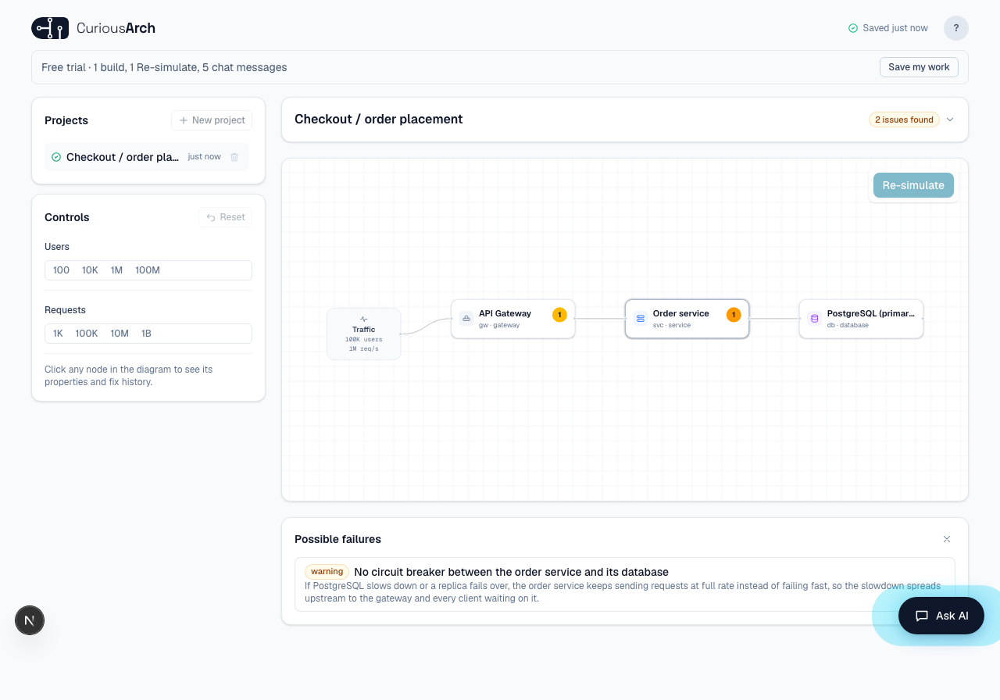

# CuriousArch

**An architect-in-a-box for distributed systems.** Describe what you're building in plain English, get back a rough architecture diagram, and see what actually breaks it — thundering herds, cascading failures, single points of failure — before you ever write code.

Live at **[curiousarch.com](https://curiousarch.com)** — try it as a guest, no sign-up required for your first build.



## What it does

1. **Describe** a system in a sentence or two ("A checkout service behind a gateway, backed by Postgres with read replicas, rate limiting on, no circuit breaker yet.")
2. CuriousArch infers a rough architectural model — components and how they connect, each tagged with a handful of **categorical** traits (`instanceCount: "single"`, `hasCircuitBreaker: false`) — never invented numbers.
3. A separate AI pass reviews that model like a senior architect would, and flags real risks: single points of failure, thundering herds, cascading failures, unbounded admission, data loss on an unversioned store, and more — each with a plain-English explanation and a concrete fix.
4. Pick a fix (or just ask for a change in chat), **Re-simulate**, and see whether the risk actually cleared — not just whether you clicked a button.
5. Raise the scale (100 users → 100M) and watch which protections the AI decides you'd actually need at that scale, and which risks only start to matter once you get there.

It's a learning tool, not a capacity planner: the point is to build the instinct for *what* breaks systems and *why*, not to compute queueing math.

## Why it's built the way it is

- **Judgment belongs to the AI; code only enforces structural validity.** The model is never asserted by a hardcoded pattern catalogue — a free-form AI call reasons over the architecture like a person would, and the engine code only ever checks things that need no design opinion to call wrong (a cycle, a dangling edge, two components sharing an id, a queue with no consumer). See [`docs/context/product-decisions.md`](docs/context/product-decisions.md).
- **This started as a numeric simulator and got pulled back on purpose.** An earlier version ran real queueing math (M/M/c, Erlang B/C) over AI-inferred numbers. It got deleted after a live incident showed an LLM will confidently explain a failure it didn't actually compute, inventing a plausible-sounding mechanism that was simply wrong. The model is categorical now — booleans and small closed choices, never a number the AI computes — because that's the kind of question an LLM can actually answer reliably. The full story, kept on purpose because the reasoning still matters: [`docs/context/history-and-pivot.md`](docs/context/history-and-pivot.md).
- **A validation gate sits between every AI generation and the screen.** If a result breaks a hard structural rule (a lost connection, something scaled up with no justification, a queue the diagram forgot to finish wiring), it's never shown — the engine retries once with the violation named, and only a previous-version fallback with a plain explanation ever reaches the user. See [`docs/context/inference-reliability.md`](docs/context/inference-reliability.md).
- **A guest trial with real server-side quota**, not a client-side gate — Supabase anonymous sign-in plus a Postgres-enforced daily budget, so a guest gets one real build before being asked to sign in.

## Tech stack

| Layer | What |
|---|---|
| Frontend | Next.js 16 (App Router), React, Zustand, React Flow + ELK.js for the diagram layout, Tailwind |
| Backend | Next.js API routes on the Node.js runtime — no separate backend service |
| AI | Anthropic Claude, called directly via the Messages API with structured tool-use output — Sonnet 5 for reasoning calls (topology, failure analysis, chat), Haiku 4.5 for a cheap utility extraction call |
| Database / auth | Supabase (Postgres + Row-Level Security, including anonymous "guest" auth) |
| Hosting | Vercel |
| Testing | Vitest — **680 tests** across both workspaces |

## Repo structure

```
packages/engine/   Headless inference engine — no React, no DOM, independently testable.
                    Prose -> SystemModel -> AI-reviewed findings. See packages/engine/README.md.
apps/web/           Next.js App Router UI: the diagram, controls, chat, fixes, accounts,
                    the guest trial, usage tracking. See apps/web/README.md.
docs/               Deployment guide, the multi-agent production-readiness review process,
                    and docs/context/ — the running design-decision log this project was
                    built against (start at CONTEXT.md).
plans/              The phased product roadmap, from where the project currently stands onward.
```

`apps/web` consumes `packages/engine` as an npm workspace package — the inference logic is fully decoupled from the UI and has its own test suite.

## Getting started

```bash
npm install
npm test           # 680 tests across both workspaces
npm run typecheck
npm run dev         # serves apps/web at http://localhost:3000
```

Running the web app locally needs a few environment variables (an Anthropic API key, a Supabase project) — see [`apps/web/README.md`](apps/web/README.md) for the full setup, and [`docs/DEPLOYMENT.md`](docs/DEPLOYMENT.md) for deploying it yourself.

## How this was built

This project was built in close collaboration with Claude (Anthropic's AI), including a self-run, repeatable **multi-agent production-readiness review**: six parallel specialist AI reviews (security, correctness, performance/cost, accessibility, tests/CI, ops/deploy) audit the code before each release, with every finding independently re-verified against the actual code before anything is fixed. The pattern, its findings, and what was fixed each run are recorded in [`docs/orchestration/`](docs/orchestration/).

The full running design-decision log — what changed, why, and what was tried and reverted — lives in [`CONTEXT.md`](CONTEXT.md) and [`docs/context/`](docs/context/), if you want to see the reasoning behind the product as it was actually built, not just the result.

## License

All rights reserved — see [`LICENSE`](LICENSE). This repo is public for reading, not licensed for reuse. Reach out if you'd like to use any of it.
